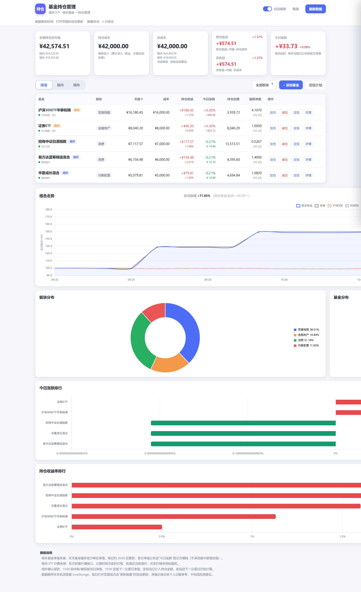
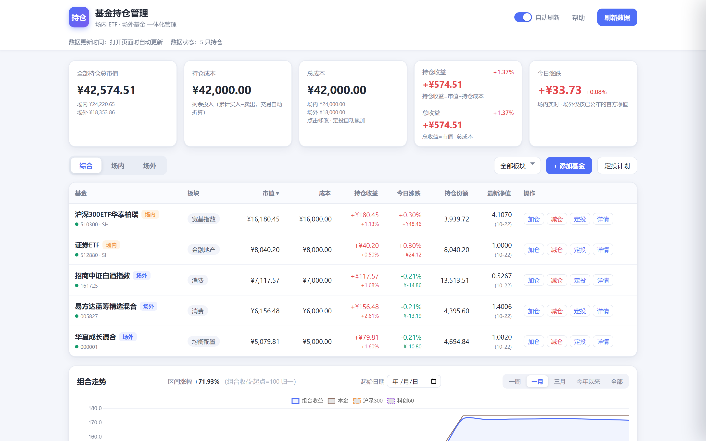

# FundFolio · 基金持仓管理

> 场内 ETF × 场外基金 一体化持仓管理。单文件、零后端、离线优先。**在线体验：[lihalf0312.github.io/fundfolio](https://lihalf0312.github.io/fundfolio/)**（首次打开自动载入示例数据，可直接把玩全部功能；标题旁的「示例数据」角标提示当前为演示模式）





## 它是什么

一个给真正在定投、加减仓的人用的持仓工具：不只记账，而是把**场内 ETF 的实时行情口径**和**场外基金的官方净值口径**放进同一套账本里算清楚。数据全部存在浏览器本地，不上传任何服务器。

- **单 HTML 文件**（约 100 KB + Chart.js CDN）：无框架、无构建、无后端，任意静态托管可跑。
- **真实数据源**：场内行情走东财 push2 接口，场外净值走天天基金 pingzhongdata / fundmobapi，全部通过 JSONP / script 注入绕过浏览器跨域限制，接口限流时自动退避重试。
- **内置示例数据**：首次访问自动载入 5 只示例持仓 + 定投计划（也可一键生成），演示完整功能，与真实数据隔离；清空后不会重复注入。

## 功能与口径设计（这个项目真正难的地方）

- **两套净值口径并存**：场内 ETF 用实时行情（含盘中估值标记），场外基金只用已公布的官方净值——官方净值公布前"今日涨跌"显示为横线，而不是拿估值冒充。
- **QDII / 净值延迟确认**：场外买入先记金额、份额待净值公布后自动按「金额 ÷ 确认日净值」补齐（`confirmNavDate` 机制），QDII 净值晚一天公布也能自动对齐。
- **15:00 申赎界线**：每笔交易记录 15:00 前/后，决定确认净值用当日还是下一交易日，节假日顺延。
- **定投计划**：按交易日自动执行（金额先入账、场外份额净值公布后自动确认），支持周/月频率、暂停与补执行。
- **组合走势**：组合收益 vs 本金线 vs 沪深300 / 科创50 归一对比（起点=100），支持自定义起始日期；份额按"并集日期"逐日推进而非按单只基金历史快照，避免净值缺失日（如 QDII 滞后）造成走势跳变。
- **成本口径**：总成本底数可手动校准（场内/场外分开），定投自动累加；快照建仓支持"只知总额不知份额"的迁移场景。
- **收益排行**：持仓收益 / 收益率双排行，红涨绿跌（A 股配色习惯）。

## 技术要点

| 维度 | 取舍 |
| --- | --- |
| 架构 | 单文件、无构建链；单一 state 对象 + `renderAll()` 全量重绘 |
| 数据获取 | JSONP / script 注入绕过 CORS；带重试与退避的接口封装 |
| 数据一致性 | 官方净值 vs 估算值的口径分离；份额确认的状态机（在途 → 确认） |
| 持久化 | localStorage（状态与净值缓存分离，`fundfolio_v2` / `fundfolio_navcache_v2`） |
| 隐私 | 数据不出浏览器；示例数据与真实数据隔离 |

## 与 AI 的协作方式（Vibe Coding）

需求、口径设计和验收由人定义（两套净值口径、15:00 界线、QDII 延迟确认这些规则来自真实情况），AI 负责实现，人用真实持仓验收并驱动迭代。几轮典型迭代：

1. **口径分裂问题**：场内实时价与场外滞后净值混在一个"总收益"里失真 → 拆分为场内/场外双成本底数与分栏展示。
2. **净值滞后导致的份额空洞**：场外买入后净值未公布时份额未知 → 设计"在途金额 → 净值确认转份额"的两阶段状态。
3. **走势跳变**：单只基金历史缺失日把当日交易推迟计入 → 份额改为按并集日期逐日推进。
4. **跨域与限流**：行情接口被 CORS 拦截且偶发限流 → JSONP 封装 + 指数退避重试。

## 本地运行

```bash
# 直接双击 index.html 即可；或起个静态服务：
python -m http.server 8080
# 打开 http://localhost:8080（首次访问自动载入示例数据）
```

## License

[MIT](LICENSE)
